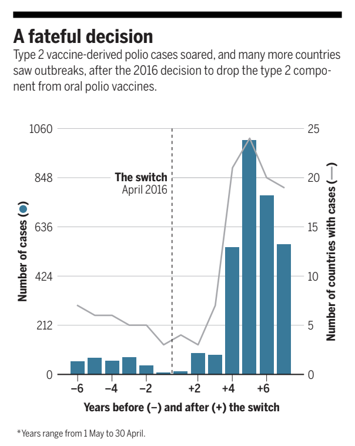
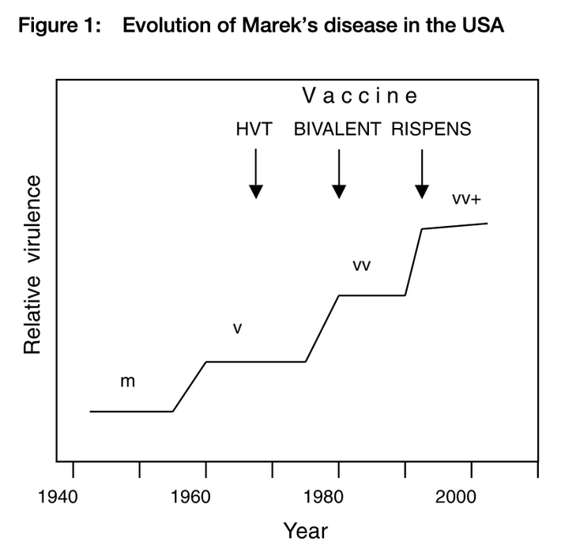
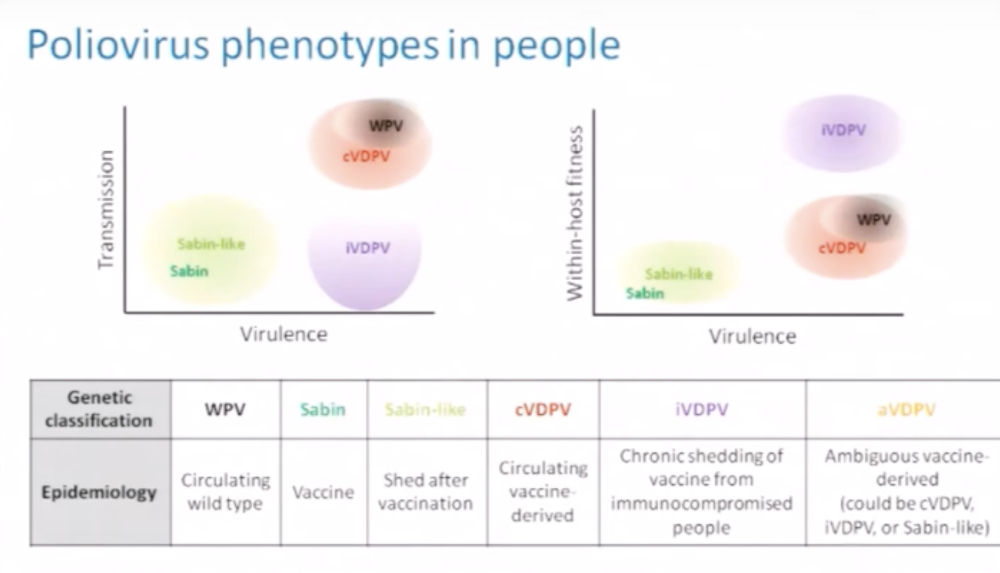
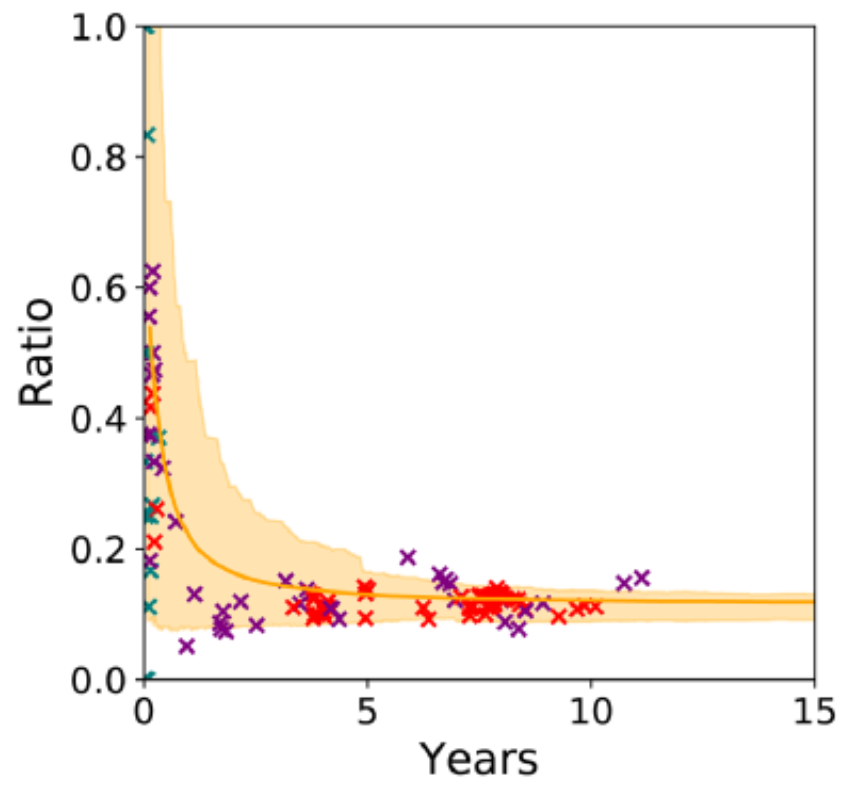
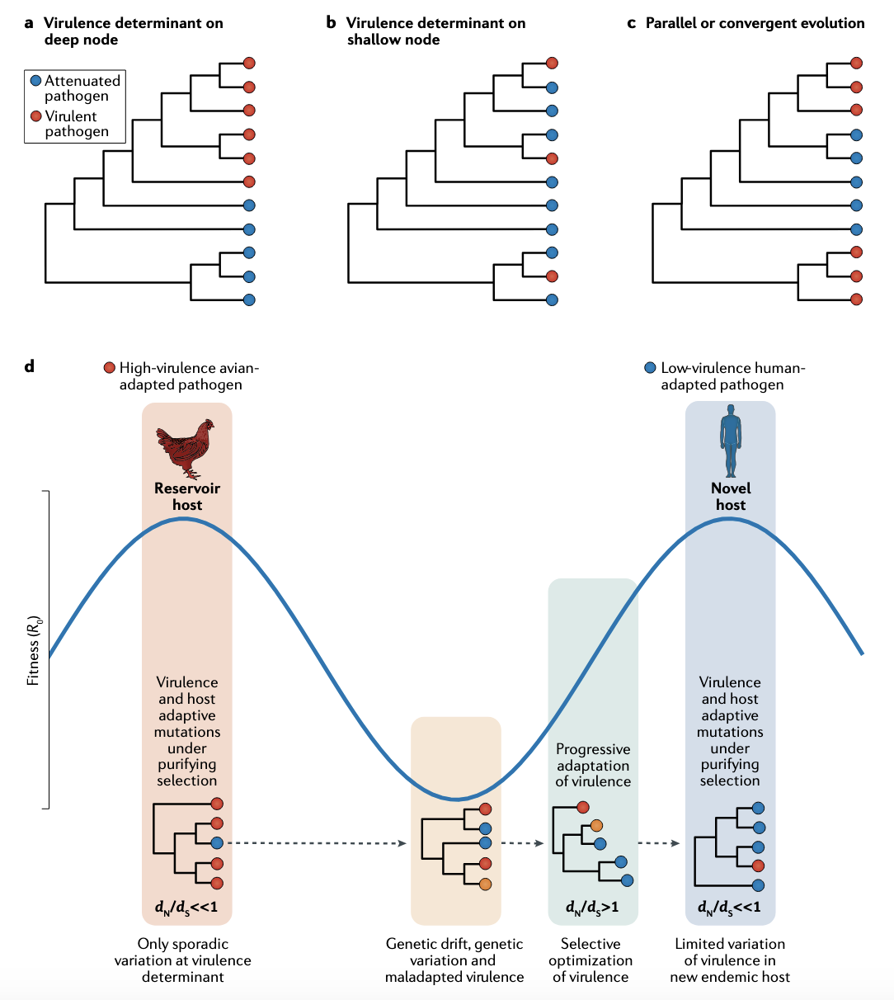
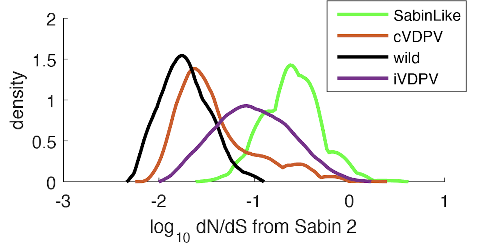

## Introduction

### "The switch"

*Figure 1: Reproduced from Roberts 2024.[1](#ref-1)*

I became interested in the topic of vaccine virulence due to treatments after reading articles on "the switch" of oral poliovirus vaccines in April 2016, when 155 countries began use of an altered version of the classic Sabin oral poliovirus vaccine (OPV) that did not protect against Type 2 poliovirus in routine immunizations.[1](#ref-1)–[3](#ref-3) Due to OPV being a live-virus vaccine, it can replicate and shed in stool of vaccinated individuals. It also has the rare possibility of circulating vaccine-derived poliovirus (cVDPV) after reversion to widltype pathogenicity. It has led to the reduction of over 99.9% of polio cases since 1988. After the Global Polio Eradication Initiative (GPEI) had declared the wildtype Type 2 poliovirus to be eradicated in 2015 (the last wildtype Type 2 poliovirus was observed in 1999), "the switch" was coordinated to prevent cVDPV2 as well, since it is introduced by OPV. Besides discontinuation of classic OPV, officials stockpiled an oral vaccine targeted solely to Type 2 to be used during supplementary immunization activities (SIAs) to prevent current outbreaks of cVDPV2 (OPV2), as well as started to use the killed, injected poliovirus vaccine (IPV) in Lower-and-Middle Income Countries (LMIC), which prevents disease but does not prevent transmission.

Unfortunately, children not vaccinated against Type 2 became susceptible, and cVDPV2 began to circulate among them; 3 to 4 years after "the switch," "cases jumped from 84 in seven countries to 548 in 21 countries," and "the number of cases has increased tenfold since 2015."[1](#ref-1) The catch-22 is that one needs to vaccinate as many children as possible against Type 2 in order to prevent outbreaks, yet vaccination also leads to the possibility of further cVDPV2.[2](#ref-2) At the end of a technical report by the GPEI, an epilogue was also written: that there is a "moral imperative" to rehabilitate and educate those children who have been paralyzed, as well as to protect health-workers on the ground administering the vaccine, primarily in Pakistan, given that over 100 of them have been assassinated.[1](#ref-1)

Many vaccines are live-virus vaccines, which can provoke stronger immune responses in comparison to inactivated, or killed, vaccines. These include varicella vaccines,[4](#ref-4) as well as, more recently, transmissible vaccines for animal populations, where the vaccine replicates within hosts is transmitted between hosts in order to provoke an immune response in hard-to-vaccinate populations. Knowing the risks of virulence evolution of these vaccines can be challenging.[5](#ref-5)

### Imperfect vaccines

Virulence evolution of wildtype strains has also been extensively studied.[6](#ref-6) When a tradeoff between infection duration and transmission is assumed as virulence increases, the optimal virulence strategy will evolve to be intermediate (rather than one of the two extremes of very high virulence or very low virulence). Ecological factors that could select for higher virulent strategies by modifying this tradeoff include imperfect vaccines, where within communities of vaccinated individuals the costs of higher virulence have been lowered since disease is prevented, but the virus can still circulate among the community, selecting for higher virulence.[7](#ref-7) This evolutionary phenomenon has been suggested to have occurred in Marek's disease virus.[8](#ref-8),[9](#ref-9) Note that this is different from a live-virus vaccine reverting to pathogenicity: the vaccine creates conditions that select for higher virulence of the wildtype strain.

*Figure 2: Reproduced from Fehler et al. 2001.[9](#ref-9)*

While such theoretical models are important to identify ecological factors that may select for higher virulence, such as imperfect vaccines, they normally lack a genetic basis.[10](#ref-10) Doubts have been raised on the generalizability of such a theoretical model,[10](#ref-10)–[12](#ref-12) since many other factors besides virulence affect virus transmissibility and infection duration. More recent research has also proposed that case detection may be the important tradeoff factor, rather than death.[13](#ref-13) MDV may actually represent an edge case rather than the norm given that many human infections do not exhibit this behavior.[11](#ref-11) These reasons include:

- High crowding of birds in industrial settings.
- Vaccination is near 100%.
- Because MDV is an alpha herpesvirus, it has many anti-immune responses, allowing for multiple pathways of pathogen evolution.

Furthermore, a reason that this evolutionary phenomenon may not occur for other pathogens may come down to immunological complexity: innate immunity normally attacks conserved regions of pathogens and thus the immune response may not be evaded by evolution so easily, in comparison to the later stage of interactions with adaptive immunity.[11](#ref-11) Opposite results, such as higher virulence giving a competitive edge to the malaria parasite within hosts, also suggest some fragility to the model: unaccounted ecological factors can flip model results. Basing policy on such a model, such as whether to use an imperfect vaccine, is then fraught with uncertainty, and may be detrimental if the evolutionary result only occurs in very specific situations, lacking generality. Although differences in virulence certainly do exist,[14](#ref-14) assumptions of the evolutionary tradeoff, transmission model, process of evolution, and sometimes a lack of within-host modeling, can be too strong. Among these assumptions:

- Most evolutionary models assume the resident population comes to fixation before introduction of a mutant, not addressing transient dynamics. They also assume that mutations can only change virulence by a small amount in each time step, which may not be the case.
- Models that solely consider between-host transmission may be misspecified since they lack within-host processes, such as co-infection, which can flip results of the predicted impact of ecological factors such as higher host mortality.[15](#ref-15)
- The observed tradeoff between virulence and transmission, oft-assumed, is unknown for many pathogens.[16](#ref-16)

Yet the elegance of simple models, although they normally ignore within-host complexities, are rationale of their use: they are normally analyzable, giving us insight into the transmission and evolution of pathogens.[17](#ref-17) Empirical experiments can then be done to check the predictions of the model.[8](#ref-8) Some literature argues however that these simple evolutionary predictions must be based on other data sources, such as genetic viral sequences, even before empirical experiments.[10](#ref-10)

### Call for more complex modeling approaches

Clearly, whether or not vaccines revert to virulence or select for higher virulence, and then fixate in a population, is of utmost concern. The conundrum is that these same vaccines prevent infection and mitigate widespread circulation. Part of carefully assessing the pros and cons of proposed use of a vaccine then relies on estimation of the risk of virulence evolution due to, or of, the vaccine.

## Solutions to address eco-evolutionary complexities

There have been many recent developments to address the eco-evolutionary complexities of virulence evolution. There are many definitions for pathogen virulence, and implicitly this definition is host-dependent. Here, I define virulence as the host mortality rate due to disease, which may due to such within-host factors as higher replication.

### Transmission modeling

An important nuance of virulence evolution is that just because virulence evolution occurs, this does not mean it will fixate in the population. In other words, it is a necessary, but not sufficient conditions for cVDPV2 emergence. A striking feature of Type 2 OPV is that it will revert to wildtype pathogenicity very quickly: on average 10 to 100 days into shedding,[18](#ref-18) meaning that even in a single vaccination it can revert. And yet these wildtype-like strains do not always fixate in the population. We would like to know the risk factors for cVDPV2 circulation, since for example, since between "the switch" and November 2019, 300 million doses of OPV2 have been administered in response to 325 paralytic cases, leading to increases of 1800 cases of cVDPV2 in 30 countries between January 2020 and April 2022.[3](#ref-3)

Polio is an excellent system to explore these eco-evolutionary complexities because of how much we know about virulence evolution in this system:

- We know the gateway mutations of virulence.
- We know that virulence has convergent evolution, consistent with a selective advantage of high virulence.
- We already have some idea of a risk of virulence evolution (roughly 1 in 100 million exposures leads to cVDPV2 emergence)
- We have both transmission data as well as genomic data to base predictions.
- We have some idea of the tradeoff between virulence and transmission (although exceptions to the rule are possible, see Figure 3).

*Figure 3: Reproduced from Farmulare 2018[18](#ref-18)*

*Figure 4: Reproduced from Wong et al 2023.[3](#ref-3)*

There has been some research in polio to simulate both the between-host contact structure (in different communities) as well as within-host complexities of shedding duration, immunity, viral titer levels, and susceptibility.[3](#ref-3) A transmission modeling approach, with a within-host component, may be most fruitful to understanding the conditions where virulent strains are expected to fixate. Sanitation and low-population densities for example, are key to avoiding the risk of cVDPV2. Incorporation of the dN/dS evolutionary rate (see Figure 4 below) are also key. With polio trial data, the authors went through the trouble of inferring rates of nonsynonymous and synonymous mutations, as well as of the nonsynonymous mutations, whether they were neutral or deleterious. A genotype-to-phenotype map was also created: this is most important for the gatekeeper mutations, but also deleterious mutations were calibrated to lead to a slight decrease in infectiousness (as measured and simulated with viral titer levels). Additionally, mutations that fixate earlier after vaccination have higher fitness effects than later. Probabilities of infection, via viral titer levels, increase with each gatekeeper mutation. Transmission is a function of viral shedding rate of the infecter and susceptibility of the infectee. One can see that successful circulation then depends on various epidemiological factors: if a person has the reverted strain, but does not shed at a high rate, or has a short shedding duration, or does not have necessary contacts to prolong circulation, cVDPV2 will not circulate. On the between host scale, 10% to 90% of children under 5 are vaccinated in a population of 80,000 individuals across 45 villages over approximately 3 years.

When simulating the epidemic, 40% of simulations showed stochastic die-out of epidemics. Across simulations, possible phenotypes of shedding durations and viral infectiousness varied widely due to genetic drift, and were inversely proportional to infection counts. Higher fecal-oral transmission, which can occur in unsanitary conditions, led to greater risk of cVDPV2, as did lower vaccination and boosting. Importantly, low-coverage campaigns, especially one year post-cessation of vaccination, exhibited large probabilities of outbreaks. The risk of outbreaks falls after the first year after cessation of a vaccination campaign, but steadily rises due to declining vaccination coverage. Even with so much modeling, some things are left out such as possible recombination with human enterovirus C as well as differing intra-host rates of selection.[19](#ref-19) But the broad strokes conclusions show that the host ecology and epidemiology is fundamental to whether virulent strains are allowed to fixate in the population.

### Phylogenomic approach

*Figure 5: Reproduced from Geoghegan and Holmes 2018.[10](#ref-10)*

Phylogenomic approaches can be used to identify virulence determinants, as well as the nature of virulence evolution, e..g., whether it is associated with higher fitness. The former can be done by simply matching "key branches" of an inferred phylogeny to events such as marked increase in mortality and morbidity and invasions into new geographic areas. Figure 5 shows an example of how the latter can be done.[10](#ref-10) Specifically, if mutations are (1) associated with higher virulence fall deeper on a tree, (2) occurring multiple times in the tree (convergent evolution, (3) dN/dS is much greater than 1 during the emergence of the virulence determinant (adaptive evolution), then becomes much smaller than 1 (purifying selection). For example, if all three occur, or some combination of the three occur, this would be consistent with virulence being advantageous for the pathogen in a certain population.

Since these mutations may also be part of other evolutionary tradeoff traits if there is a positive correlation between virulence and these other traits, this would further illuminate how virulence evolution may be dependent on the tradeoffs of these other traits as well. Challenges of these types of approaches include epistatic effects, as well as that if virulence determinants are caught early, they will necessarily be closer to the tips of the phylogeny rather than the roots even if they may have a true selective advantage.

*Figure 6: Reproduced from Wong et al 2023.[3](#ref-3)*

In Figure 6, what this is showing are the dN/dS rates in the capsid for several strains, measured as the number of nonsynonymous changes to synonymous changes in reference to the vaccine strain. The lowest dN/dS is of the wildtype, and on the other extreme, are the Sabin-like strains, which are exploring the highest amount of amino-acid space.

## References

1. Leslie Roberts. Report offers harsh verdict on global polio vaccine switch. *Science*, 384(6696):608–609, 2024.
2. Apoorva Mandavilli. The pivotal decision that led to a resurgence of polio. *New York Times*.
3. Wesley Wong, Jillian Gauld, and Michael Famulare. From vaccine to pathogen: Modeling sabin 2 vaccine virus reversion and evolutionary epidemiology in matlab, bangladesh. *Virus Evolution*, 9(2):vead044, 2023.
4. Judith Breuer. Molecular genetic insights into varicella zoster virus (vzv), the voka vaccine strain, and the pathogenesis of latency and reactivation. *The Journal of Infectious Diseases*, 218(suppl_2):S75–S80, 2018.
5. Daniel G Streicker, Megan E Griffiths, Rustom Antia, Laura Bergner, Peter Bowman, Maria Vitoria dos Santos de Moraes, Kevin Esvelt, Mike Famulare, Amy Gilbert, Biao He, et al. Developing transmissible vaccines for animal infections. *Science*, 384(6693):275–277, 2024.
6. Samuel Alizon, Amy Hurford, Nicole Mideo, and Minus Van Baalen. Virulence evolution and the trade-off hypothesis: history, current state of affairs and the future. *Journal of evolutionary biology*, 22(2):245–259, 2009.
7. Sylvain Gandon, Margaret J Mackinnon, Sean Nee, and Andrew F Read. Imperfect vaccines and the evolution of pathogen virulence. *Nature*, 414(6865):751–756, 2001.
8. Andrew F Read, Susan J Baigent, Claire Powers, Lydia B Kgosana, Luke Blackwell, Lorraine P Smith, David A Kennedy, Stephen W Walkden-Brown, and Venugopal K Nair. Imperfect vaccination can enhance the transmission of highly virulent pathogens. *PLoS biology*, 13(7):e1002198, 2015.
9. Frank Fehler. Marek's disease: History, actual and future perspectives. *Lohman Inf.*, 25:1–5, 2001.
10. Jemma L Geoghegan and Edward C Holmes. The phylogenomics of evolving virus virulence. *Nature Reviews Genetics*, 19(12):756–769, 2018.
11. James J Bull and Rustom Antia. Which 'imperfect vaccines' encourage the evolution of higher virulence? *Evolution, Medicine, and Public Health*, 10(1):202–213, 2022.
12. Dieter Ebert and James J Bull. Challenging the trade-off model for the evolution of virulence: is virulence management feasible? *Trends in microbiology*, 11(1):15–20, 2003.
13. David A Kennedy. Death is overrated: the potential role of detection in driving virulence evolution. *Proceedings of the Royal Society B*, 290(1995):20230117, 2023.
14. Dong-Hun Lee, Miria Ferreira Criado, and David E Swayne. Pathobiological origins and evolutionary history of highly pathogenic avian influenza viruses. *Cold Spring Harbor perspectives in medicine*, 11(2):a038679, 2021.
15. Dieter Ebert and Katrina L Mangin. The influence of host demography on the evolution of virulence of a microsporidian gut parasite. *Evolution*, 51(6):1828–1837, 1997.
16. Ian F Miller and C Jessica Metcalf. Vaccine-driven virulence evolution: consequences of unbalanced reductions in mortality and transmission and implications for pertussis vaccines. *Journal of The Royal Society Interface*, 16(161):20190642, 2019.
17. Mike Boots. The need for evolutionarily rational disease interventions: vaccination can select for higher virulence. *PLoS Biology*, 13(8):e1002236, 2015.
18. M. Farmulare. Evolutionary epidemiology of vaccine-derived poliovirus transmission. <https://www.youtube.com/watch?v=83X-HwkMp3g>.
19. Glynis Dunn, Dimitra Klapsa, Thomas Wilton, Lindsay Stone, Philip D Minor, and Javier Martin. Twenty-eight years of poliovirus replication in an immunodeficient individual: impact on the global polio eradication initiative. *PLoS pathogens*, 11(8):e1005114, 2015.
