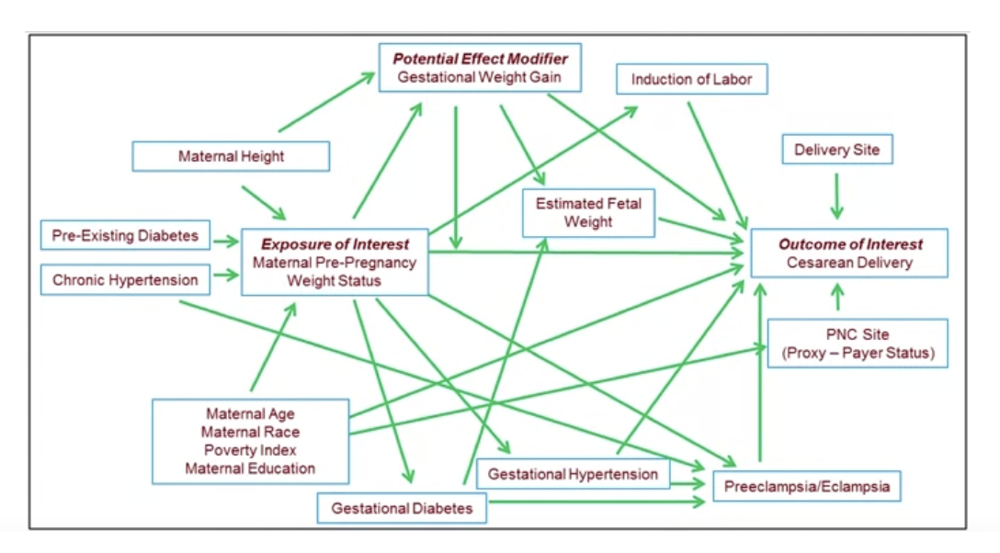

## Introduction

The following is adapted from module two of Prof. Jason Roy's online Coursera course on causal inference <https://www.coursera.org/learn/crash-course-in-causality>.[1](#ref-1) I wanted to review the basics of causal inference for myself. This is part two of five.

## Confounding

*Confounding* occurs when some factor affects both the treatment and outcome. For example, if in a trial older people are more likely to receive a particular treatment for cardiovascular disease, as well as have higher risk for cardiovascular disease, then age would be a confounder. In contrast, if age solely increases the risk for cardiovascular disease (the outcome) and not the treatment assignment, this would not be a confounder. If just the treatment is based on some factor, but not the outcome is not dependent on this factor, this would also not be a confounder. To control for confounding, we are interested in a set of variables $$X$$ that will allow us to achieve ignorability, or independence between the potential outcomes and the treatment assignment.

### Preliminary: DAGs

One way for us to keep track of controlling for confounding is to use *causal graphs* diagrams. We use directed-acyclic graphs (DAG). If we have:

$$D \rightarrow A \rightarrow B \quad C$$

Then we know certain relationships between the variables:

- $$P(C \mid D, A, B) = P(C)$$, i.e., $$C$$ is independent of all variables
- $$P(B \mid D, A, C) = P(B \mid A)$$, i.e., $$B \perp\!\!\!\perp D, C \mid A$$
- $$P(B \mid D) \neq P(B)$$, i.e., $$B$$ and $$D$$ are marginally dependent
- $$P(D \mid B, A, C) = P(D \mid A)$$, for similar reasons as for point two

Here is another example:

$$A \leftarrow D \rightarrow B \rightarrow C$$

Where we know the following relationships:

- $$P(A \mid D, B, C) = P(A \mid D)$$, i.e., $$A \perp\!\!\!\perp B, C \mid D$$
- $$P(D \mid A, B, C) = P(D \mid A, B)$$, i.e., $$D \perp\!\!\!\perp C \mid B$$

Given a DAG we can decompose the joint distribution. We do this by starting with the roots of the DAG and writing down any dependencies of each child (note: if a child has two parents then we need to condition on both parents). For example in the first example the joint distribution would be $$P(A, B, C, D) = P(C)P(D)P(A \mid D)P(B \mid A)$$. The joint distribution of the second example would be $$P(A, B, C, D) = P(D)P(A \mid D)P(B \mid D)P(C \mid B)$$. We say that a DAG and a joint distribution are *compatible*. For a given DAG, we can write down its joint distribution function, but a given joint distribution may not necessarily be unique to one DAG.

Some examples of other terms to know:

- Fork: $$A \leftarrow D \rightarrow B$$
  - Note that $$A$$ and $$B$$ are not independent because information flows from $$D$$ to both
- Chain: $$A \rightarrow D \rightarrow B$$
  - Again, here $$A$$ and $$B$$ are not independent
- Inverted fork: $$A \rightarrow D \leftarrow B$$
  - Here $$D$$ is a *collider*. $$A$$ and $$B$$ are independent because there is no information flow between them. If you were to condition on $$D$$, you would create an association between $$A$$ and $$B$$. Imagine $$A$$ and $$B$$ are light switches that are determined by coin flips and $$D$$ is whether a lightbulb is on, and it can only be on if both $$A$$ and $$B$$ are on. If we know the condition of $$A$$ this doesn't tell us anything about $$B$$ and vice-versa. However, if we know the lightbulb is off, then we know that $$A$$ must be on if $$B$$ is off and vice-versa.
- Blocking: $$D$$ is blocking the path $$A \rightarrow D \rightarrow B$$.
  - Imagine $$A$$ is temperature, $$D$$ is icy sidewalks and $$B$$ is if someone falls. Here $$D$$ and $$B$$ are marginally associated. But if we condition on $$A$$, then $$D$$ and $$B$$ are not associated according to this path. This can also occur on a fork like $$A \leftarrow D \rightarrow B$$.

A path is d-separated by a set of nodes $$C$$ if for all chains and forks it contains the middle part of each, and for inverted forks it does not contain the middle part nor any descendants of the middle part. Two nodes $$A$$ and $$B$$ are said to be d-separted by a set of nodes $$C$$ if every path from $$A$$ to $$B$$ is blocked. We attempt to create conditional independence by blocking (controlling) for $$C$$ i.e., $$A \perp\!\!\!\perp B \mid C$$.

### Controlling for confounders

Now that we've learned all about DAGs we can think about how to control for confounders. We just need a bit more terminology to do so:

- Frontdoor path: a path that emanates out of treatment to outcome such as $$Z \rightarrow Y$$ or $$Z \rightarrow W \rightarrow Y$$. These paths capture effects we want to measure such as the effect of treatment on the outcome. Note that if we are interested in the effect of $$Z$$ on $$Y$$ through $$W$$ then this would be a *causal mediation analysis*.
- Backdoor path: a path that travels from $$Z$$ to $$Y$$ through an arrow that goes into $$Z$$. For example if $$Z \rightarrow Y$$ and $$Z \leftarrow X \rightarrow Y$$ then $$X$$ would be a backdoor path. Backdoor paths confound the relationship between $$A$$ and $$Y$$.

We will need to block the backdoor paths in order to control confounders so that ignorability holds. We have two criterion that let us know if we have successfully controlled for confounders.

#### Backdoor path criterion

A set of variables $$X$$ is sufficient to control for confounding if (1) it blocks all backdoor paths from treatment to outcome and (2) it does not include any descendants of treatment. Note that $$X$$ is not necessarily unique.

Some examples of how to satisfy the backdoor path criterion:

- $$Z \rightarrow Y$$ and $$Z \leftarrow V \rightarrow W \rightarrow Y$$. There is one backdoor path to block, which we can block with $$V$$ or $$W$$ or both.
- $$Z \rightarrow Y$$ and $$Z \leftarrow V \rightarrow M \leftarrow W \rightarrow Y$$. Here there is a collider $$M$$ so there is actually no confounding. As long as there is no information flow along a backdoor path, then $$Z$$ is not associated with $$Y$$ through the backdoor path and there is no confounding. If $$M$$ was controlled you could unintentionally open up a path that would need to be controlled.

Strategy for controlling for backdoor paths: for each backdoor path, check if they have colliders or not. If they do then nothing to worry about. If they don't then control for something on the path that will block the path. Of the conditions to block each path, find the minimal set where all backdoor paths are blocked.

In practice, people come up with very complicated graphs which need to be controlled. Case in point:

*Figure S1: **DAG between maternal pre-pregnancy weight and risk of C-section.** Reproduced from Figure 1 of Vahratian et al. (2005).*

#### Disjunctive cause criterion

Suppose we don't know the true DAG. We can choose to use the disjunctive cause criterion which is simply to control for all observed causes of the exposure, outcome or both. This is due to the property that <u>if</u> there is a set of observed variables that satisfy the backdoor path criterion then the variables selected by the disjunctive cause criterion will be sufficient to control for confounding.

Here is a simple example: suppose we know pre-treatment variables $$M, V$$, and $$W$$ and unobserved pre-treatment variables $$U_1$$ and $$U_2$$. Suppose we know $$W$$ and $$V$$ are causes of $$Z$$, $$Y$$ or both and $$M$$ is not. Suppose we don't know the DAG. We can use the disjunctive cause criterion and can control for $$V, W$$ and this would be sufficient. Thus, we simply need to note which variables cause the treatment, outcome, or both, and which do not. If we simply controlled for all pre-treatment variables, due to unobserved pre-treatment variables we can unintentionally not satisfy the backdoor path criterion.

We should note that there could be a case where the backdoor path criterion cannot be satisfied simply through controlling the observed pre-treatment variables due to the unobserved pre-treatment variables not being controlled, and in this case the disjunctive cause criterion would also fail. Similarly, we also need to know all causes of $$A$$ and $$Y$$ for the disjunctive cause criterion to work. We also note that the disjunctive cause criterion set is not always smaller than the backdoor path criterion set.

## References

1. J. Roy. A crash course in causality: Inferring causal effects from observational data. <https://www.coursera.org/learn/crash-course-in-causality>.
